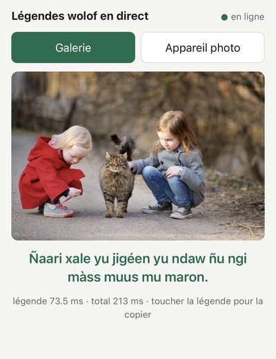
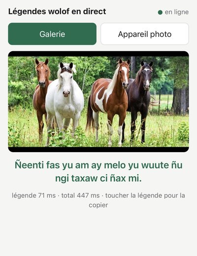
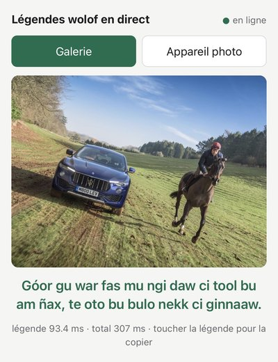
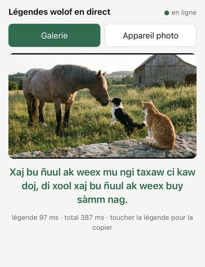
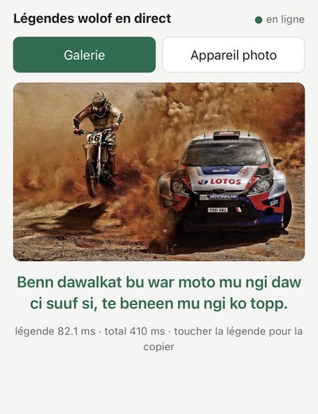
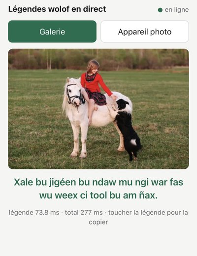
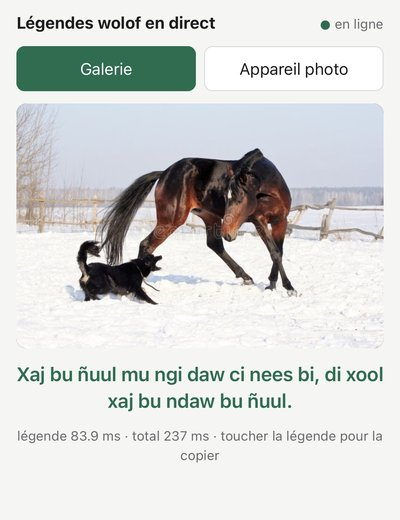

# image2wolof

Image captioning in Wolof: a frozen [SigLIP2-base](https://huggingface.co/google/siglip2-base-patch16-224) encoder (patch tokens,
196 x 768, pinned revision) and a six-layer transformer decoder (d 512, 8 heads, ff 2048, tied embeddings, 27.9 M parameters)
trained from scratch on the five machine-translated Wolof captions of every Flickr30k image ([`dataset/`](dataset/README.md)).

## Install

```bash
uv sync            # Python 3.12, torch 2.7.0 (CUDA 12.6), transformers 4.57.6
```

## Pretrained model and data

- model: [`milkymap/image2wolof`](https://huggingface.co/milkymap/image2wolof) (`best.pt` + `tokenizer.model`, epoch 6)
- captions: [`milkymap/flickr30k-wolof`](https://huggingface.co/datasets/milkymap/flickr30k-wolof) (same content as [`dataset/`](dataset/README.md), one file per split)

```bash
hf download milkymap/image2wolof --local-dir runs/flickr30k
image2wolof serve runs/flickr30k/best.pt --port 8080
```

## Pipeline

```bash
# 1. manifests {train,validation,test}.jsonl + SentencePiece unigram tokenizer (vocab 4000, fitted on train captions)
image2wolof build dataset/flickr30k_wolof.jsonl.gz --images data/images --out data/flickr30k

# 2. frozen SigLIP2 features -> data/flickr30k/features/{split}.pt (bfloat16 compute, float16 storage)
image2wolof cache data/flickr30k --images data/images

# 3. decoder training: AdamW 3e-4, warmup + cosine, bf16, label smoothing 0.1, clip 1.0, batch 128,
#    up to 20 epochs, early stopping (patience 4) on the five-caption validation loss -> best.pt
image2wolof train data/flickr30k --out runs/flickr30k
image2wolof train data/flickr30k --out runs/flickr30k --resume runs/flickr30k/last.pt
image2wolof train data/flickr30k --out runs/smoke --max-steps 300          # smoke test

# 4. five-caption loss, BLEU and chrF against the five references (sacrebleu) -> metrics.json, predictions.json
image2wolof evaluate runs/flickr30k/best.pt --data data/flickr30k --split test

# 5. captioning page and API on 127.0.0.1
image2wolof serve runs/flickr30k/best.pt --port 8080
```

Every hyper-parameter is a field of `VariablesConfig` (`src/image2wolof/settings.py`): set it in `.env` or the environment
(`EPOCHS=10`, `DEVICE=cpu`, ...); CLI options take precedence.

## Examples

Screenshots of the captioning page (`image2wolof serve`) on photos from the web, outside Flickr30k.

**Successes**

<table>
<tr><td width="25%" valign="top"><br><i>Ñaari xale yu jigéen yu ndaw ñu ngi màss muus mu maron.</i><br><sub>Two little girls are petting a brown cat.</sub></td><td width="25%" valign="top"><br><i>Benn oto bu xonq ak weex mu ngi daw bu gaaw ci pënd bi.</i><br><sub>A red and white car is racing through the dust.</sub></td><td width="25%" valign="top"><br><i>Ñeenti fas yu am ay melo yu wuute ñu ngi taxaw ci ñax mi.</i><br><sub>Four horses of different colors are standing in the grass.</sub></td><td width="25%" valign="top"><br><i>Góor gu war fas mu ngi daw ci tool bu am ñax, te oto bu bulo nekk ci ginnaaw.</i><br><sub>A man on a horse gallops across a grassy field, with a blue car behind.</sub></td></tr>
</table>

**Failures**: scenes that mix animal species or vehicle types rarely seen together in Flickr30k. The decoder falls back on
the most frequent pattern, duplicating one entity ("two dogs") or dropping another.

<table>
<tr><td width="25%" valign="top"><br><i>Xaj bu ñuul ak weex mu ngi taxaw ci kaw doj, di xool xaj bu ñuul ak weex buy sàmm nag.</i><br><sub>A black and white dog stands on a rock, looking at a black and white dog herding a cow. <b>Horse, dog and cat become two dogs and a cow.</b></sub></td><td width="25%" valign="top"><br><i>Benn dawalkat bu war moto mu ngi daw ci suuf si, te beneen mu ngi ko topp.</i><br><sub>A motorcyclist rides on the dirt and another one follows him. <b>The rally car becomes a second motorcycle.</b></sub></td><td width="25%" valign="top"><br><i>Xale bu jigéen bu ndaw mu ngi war fas wu weex ci tool bu am ñax.</i><br><sub>A little girl rides a white horse in a grassy field. <b>The dog is missing.</b></sub></td><td width="25%" valign="top"><br><i>Xaj bu ñuul mu ngi daw ci nees bi, di xool xaj bu ndaw bu ñuul.</i><br><sub>A black dog runs in the snow, looking at a small black dog. <b>The horse becomes a second dog.</b></sub></td></tr>
</table>

## API

| route | |
|---|---|
| `GET /` | upload page (gallery or camera) |
| `GET /health` | `{"status": "ok"}` |
| `POST /caption` | multipart field `files` (one or more images, 32 max, 25 MB each) -> `[{"filename", "caption", "ms"}]` |

## Results (test split, 995 images, five references)

| model | five-caption loss | BLEU | chrF |
|---|---:|---:|---:|
| SigLIP2-base + 6-layer decoder, epoch 6 | 2.792 | 41.28 | 46.19 |

BLEU `nrefs:5|case:mixed|eff:no|tok:13a|smooth:exp|version:2.6.0`, chrF `nrefs:5|case:mixed|eff:yes|nc:6|nw:0|space:no|version:2.6.0`.
Features and greedy decoding run in bfloat16: on another GPU the loss is identical to three decimals, BLEU / chrF move by a few
tenths. References are machine translations, not human Wolof.

## Layout

```
dataset/        versioned captions (images not included)
glossary/       glossary and rules given to the machine translation of the captions
src/image2wolof/
  __init__.py   CLI: build, cache, train, evaluate, serve
  settings.py   VariablesConfig
  api_server.py FastAPI server (no API docs exposed)
  static/       upload page
  services/     dataset, features, model, trainer, evaluate, captioner
tests/          uv run pytest
paper/          image2wolof.pdf (the manuscript)
data/, runs/    local only (git-ignored)
```
